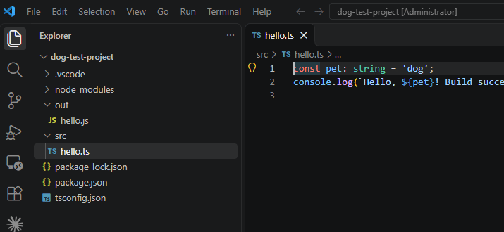

# Dog on Compile

A chihuahua dances at the top of your editor, with sound, every time a build succeeds.

## When it plays
- A successful build task (Ctrl+Shift+B, or any task in the build group).
- A successful terminal command that looks like a build, such as `npm run build`, `tsc`, `g++`, `cargo build`, `make`, `dotnet`, `gradle` or `vite`.

Keep a file open: the dog is drawn over the open editor. To see it at any time, run **Dog on Compile: Show Dog** from the Command Palette.

## Settings
| Setting | Default | What it does |
|---|---|---|
| `dogOnCompile.pattern` | build tools | Regex for task names and terminal commands that count as a build |
| `dogOnCompile.sound` | `true` | Play the sound |
| `dogOnCompile.durationSeconds` | `3` | How long the dog stays on screen |

Terminal commands are only detected in VS Code's built-in terminal.
